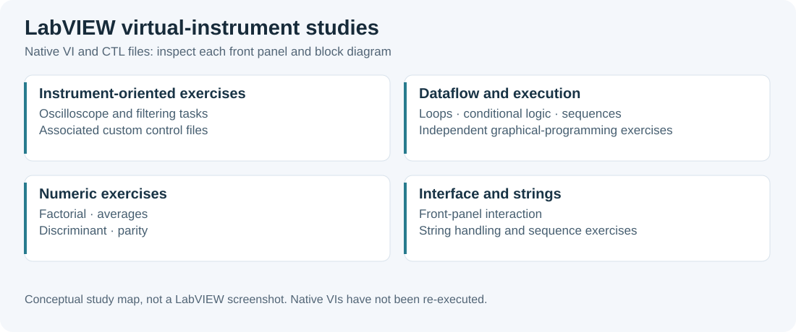

# LabVIEW Instrumentation Exercises

Virtual instruments and interface exercises covering loops, conditional logic, sequences, strings and laboratory filtering/oscilloscope tasks.

*Technical study overview based on the available repository material.*

## Repository guide

| Location | Contents |
|---|---|
| [tp_2023/](tp_2023/) | Interface, oscilloscope and filter VIs with a custom control |
| [exercices_2025/](exercices_2025/) | Factorial, averages, discriminant, parity and sequence exercises |

## Getting started

Open the `.vi` files in a compatible LabVIEW installation. Keep associated `.ctl` files with their interfaces. Inspect the front panel and block diagram before running an exercise; hardware-oriented VIs may require the corresponding instrument configuration.

## Project context

The 2025 exercises include work with Greg Alberts. Native VI files are binary; no LabVIEW execution was performed during repository organisation.

Binary project files retain their original filenames.
